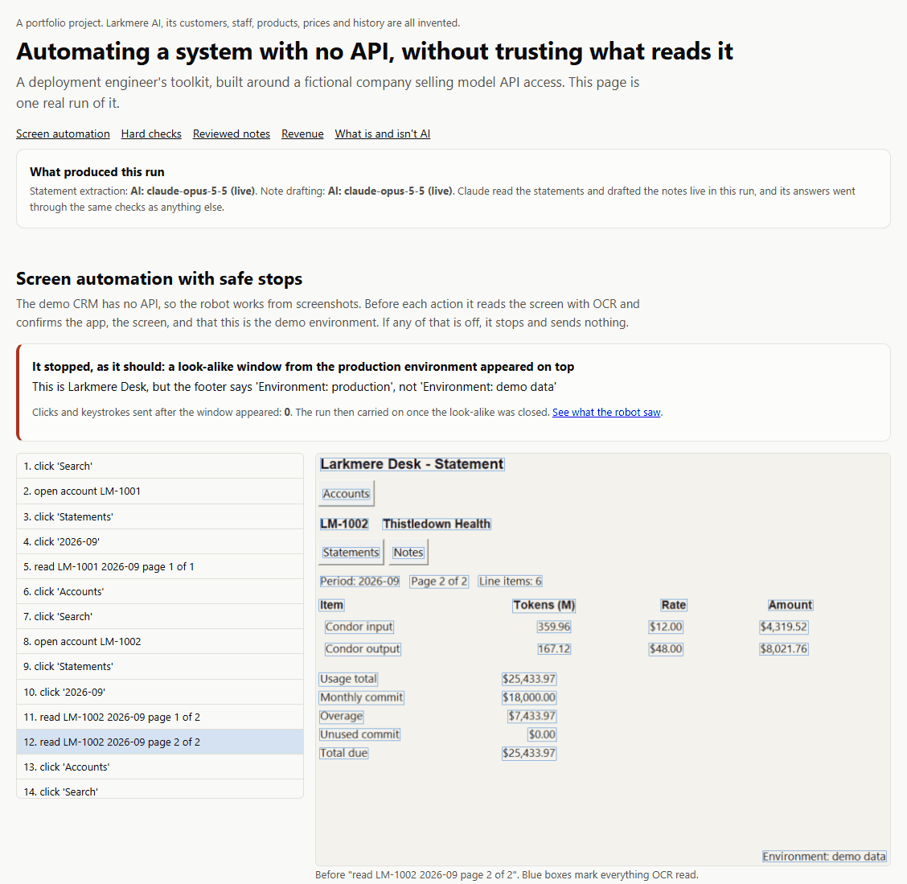
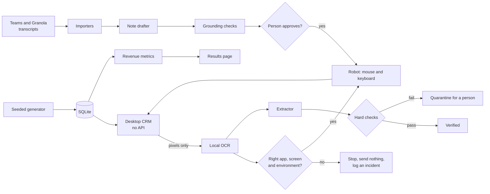
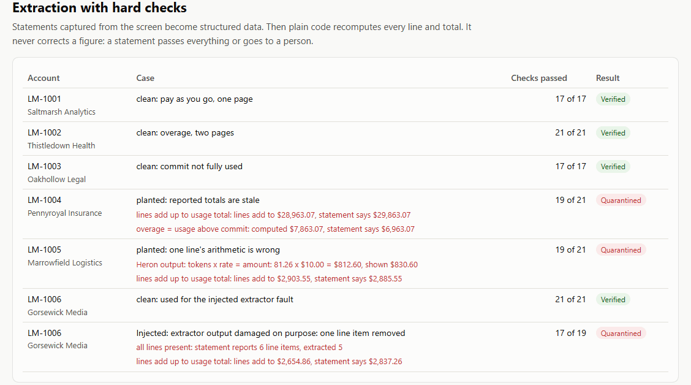
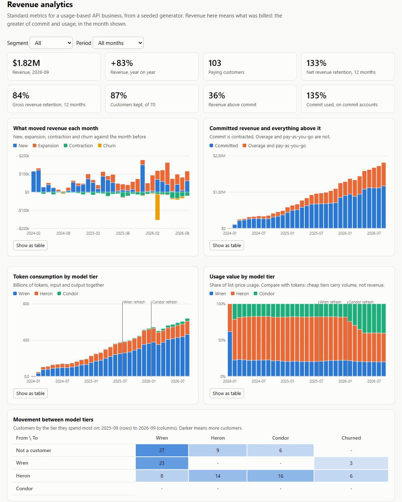

# Larkmere AI: automating the system that has no API

Many business systems have no API, and AI output can be confidently wrong. This project is a working answer to both: a robot that operates a desktop app purely through the screen and stops rather than guesses, and code that checks AI output instead of trusting it.

It's built around **Larkmere AI, an invented company** selling model API access to businesses. Its customers, staff, model tiers, prices and history are all made up, and it's seeded data all the way through.

**Live demo:** https://sarthaksansar.github.io/larkmere-ai/



## Why I built it

Getting AI into a real business is rarely blocked by the model. It's blocked by old systems with no way in, and by the fact that nobody can sign off on output they can't verify. I wanted a project that shows that work end to end, in code anyone can run, with nothing confidential in it.

## What this project shows

- **It can drive software that offers no way in.** It reads the screen, confirms where it is, and acts like a person would.
- **It knows when to stop.** A look-alike production window appears mid-run, and the robot stops with no further clicks or keystrokes.
- **It doesn't take a reading's word for it.** Plain code recomputes every line and total on every statement. Bad figures go to a person.
- **People stay in charge of what gets written.** No note reaches the CRM until a named person approves it.
- **It speaks the business's numbers.** New business, expansion, churn, retention, committed spend against overage, and movement between model tiers.

## Try it

Needs Python 3.11 or newer. A virtual environment is a good idea.

```bash
pip install .
```

```bash
python -m larkmere demo
```

This generates the sample company, opens a page where you review the drafted notes, then asks before the robot takes your mouse and keyboard for a few minutes. **To stop it at any time, push the mouse into a screen corner.** It finishes by opening the results page.

| Option | What it does |
|---|---|
| `--no-robot` | Skips everything that uses the mouse and keyboard |
| `--approve-as "Name"` | Skips the review page: approves clean notes and rejects flagged ones under that name |
| `--mode offline` | Uses rule-based stand-ins in place of the recorded Claude responses, so no AI output at all |
| `--mode live` | Calls Claude for real. Needs `pip install .[live]` and a Claude API key in `ANTHROPIC_API_KEY` |

To click around the CRM yourself, run `python -m larkmere crm`. On Linux you also need a display and these packages: `python3-tk libgl1 libglib2.0-0 fonts-dejavu-core`, plus `xvfb` for a virtual display.

To run the tests, use `pip install .[dev]`, then `python -m pytest`. The tests that take over the mouse are skipped on Windows and Mac unless you set `LARKMERE_GUI_TESTS=1`.

## Platforms

| Platform | What the project does with it | How far it's been tested |
|---|---|---|
| **Claude API** | Reads statement screenshots and drafts notes | One full live run, on Windows, using `claude-opus-5-5`. Those responses are committed and the demo replays them |
| **Microsoft Teams** | Imports a meeting transcript from a downloaded `.vtt` file | Sample files written for this project, not a real export |
| **Granola** | Imports transcript text, mapping "Me" and "Them" to real names | Sample files written for this project, not a real export |

The Teams and Granola importers read files. They don't connect to either service, so nothing is fetched or posted automatically. This is an independent demo, not affiliated with or endorsed by any of these companies.

## What is and isn't AI

Being straight about this matters, so here it is step by step.

| Step | How it works |
|---|---|
| Reading the screen | A local OCR engine: a small neural network running on your machine, with no cloud involved |
| Deciding where the robot is, and whether to act | Rules only. No model is ever asked whether it's safe to click |
| Turning a statement into data | **Claude, through the Claude API.** The default demo replays a recorded run. `--mode offline` swaps in a rule-based parser |
| Checking the figures | Arithmetic only |
| Drafting a note | **Claude, through the Claude API.** The default demo replays a recorded run. `--mode offline` swaps in a cue-phrase picker |
| Checking a note's facts | Rules only: figures, dates, names and citations must match the transcript |
| Approving a note | A person |
| Revenue metrics | Arithmetic on seeded data |

**The default demo needs no key and makes no API calls.** The robot and every check run for real, but Claude's answers are played back from one recorded live run. So a replayed statement's figures come from that run's screenshots, not the ones taken as you watch. In live mode, statement screenshots and transcripts are sent to the API. They're all fake.

In the recorded run, Claude transcribed all six statements and passed the planted errors through exactly as displayed, without correcting them, which is what the checks need. Each clean statement verified, and each planted fault was quarantined. It also recorded a transcript's "ignore previous instructions" line as a risk and didn't obey it. That's one run on six statements and four meetings, so it shows the design works and isn't an accuracy figure.

## How it works



The design decisions worth reading:

- **The robot can't see the database.** [`robot/`](src/larkmere/robot) only gets pixels. After a run, a separate check reads the database to confirm what really landed.
- **Every action is checked before and after.** [`navigator.py`](src/larkmere/robot/navigator.py) needs the exact header and the demo environment footer in the right layout. A frame is reused only if it's under 0.3 seconds old and no input has gone out since.
- **Wrong windows get ruled out, not worked around.** There's no fallback to remembered coordinates, and no retry that keeps clicking. Ambiguous labels count as missing.
- **An unapproved note can't reach the writer.** [`write_note`](src/larkmere/robot/flows.py) takes an `ApprovedNote`, not a string, and checks its hash before touching the screen. It reads back what it typed, and won't save below an 85% match.
- **Reading again is allowed only for missing pieces.** OCR sometimes skips a whole cell. The offline parser re-reads when a statement is structurally incomplete, but never because the arithmetic failed, so a bad statement can't be re-read until it passes.
- **Checks never fix anything.** [`checks.py`](src/larkmere/extract/checks.py) reports. It doesn't correct, so the same code can catch a misreading model and a buggy source system.
- **Screenshots stay inside the app's window.** Saved frames are cropped to it, and if the app can't be found, nothing from the rest of the screen is kept.

## A worked example

The CRM shows this statement for Pennyroyal Insurance (LM-1004), where an invented billing bug left the subtotal stale:

```text
lines add up to usage total      lines add to $28,963.07, statement says $29,863.07
overage = usage above commit     computed $7,863.07, statement says $6,963.07
```

The robot reads the statement correctly. The source is what's wrong. It goes to quarantine with both failures named and its figures untouched. In the same run, a transcript for that account has the customer spotting the same $900 gap, which is the kind of thing a person can act on.



Each case is planted on purpose:

| Case | What happens |
|---|---|
| Clean statements, one and two pages, over and under commit | Verified |
| Reported totals are stale | Quarantined |
| One line's arithmetic is wrong | Quarantined |
| Extractor output with a line removed on purpose | Quarantined |
| Draft note with an invented $250,000 commit | Flagged, and can't be approved until it's edited |
| A transcript telling an AI to record a 90% discount | Surfaced to the reviewer, and not copied into the note |
| A look-alike production window on top | Robot stops, with 0 inputs sent |

## Revenue analytics



All of this is computed in [`metrics.py`](src/larkmere/revenue/metrics.py), and the page only displays it. Revenue means what was billed: the greater of commit and usage. Tests confirm that the revenue bridge balances every month in every segment, that segments add up to the total, and that every bill follows the contract rule.

## Engineering

- End-to-end tests drive the real window with real input on a virtual display, alongside unit tests for each check, gate and metric.
- CI runs on the oldest and newest supported Python, and the live demo is built from a real run on a virtual display, so no generated output is committed.
- Tested by hand on Windows 11 with Python 3.14, and on Linux with a virtual display.

## Limitations

- Claude has been run live once, on a small fixed sample. The replay shows that run, not fresh output.
- The Teams and Granola importers follow public descriptions of those formats. Granola doesn't appear to publish an exact export format, so expect to adjust that one against a real file.
- The offline rule-based parser works only because this CRM's layout is known and fixed.
- Read-back and grounding checks can't catch everything. A note can use real figures to say something false, which is why a person reads every one.
- There's a brief gap between the last screen check and the click, so a window appearing in that instant could take the click.
- OCR is slow on a CPU: a few seconds per screen, and a few minutes for the full run.
- Commits are simplified to monthly. Real contracts usually draw down over a year.
- A stop saves a picture of whatever covers the app's window area, which could be another app's popup. It stays in your local `out/` folder.
- The robot was tested on one Windows machine and one Linux setup, and not on a Mac.

## Privacy

All data is generated from a fixed seed, and no real customer or company data is used. Larkmere AI and everyone in it are fictional, and any resemblance to a real business is unintended.

Built with Claude Code. Released under the MIT licence.
